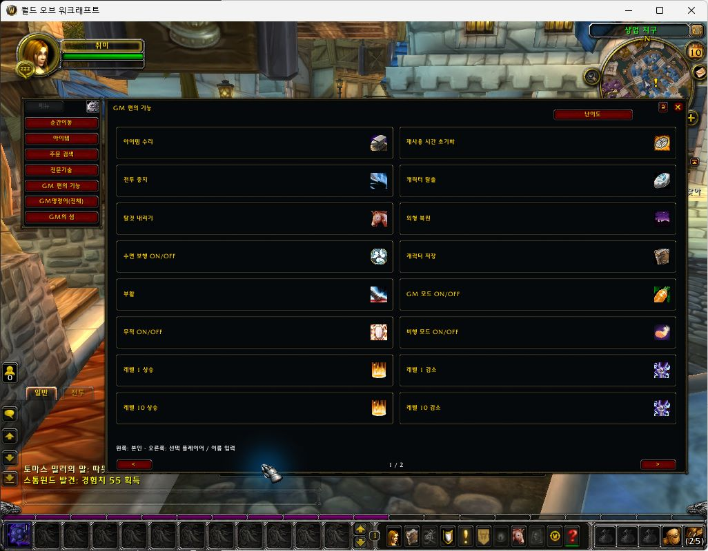
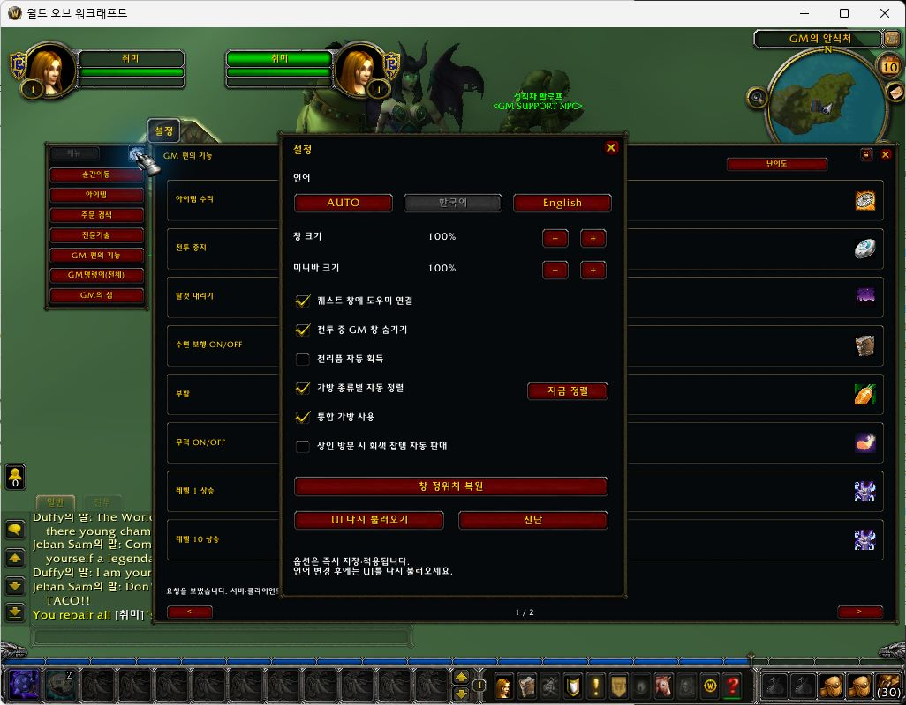
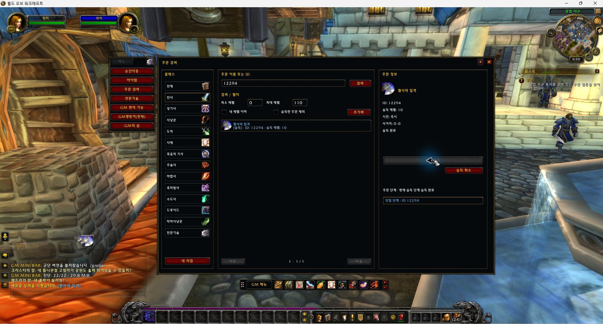
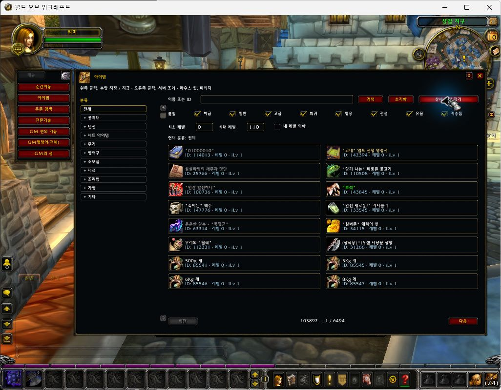
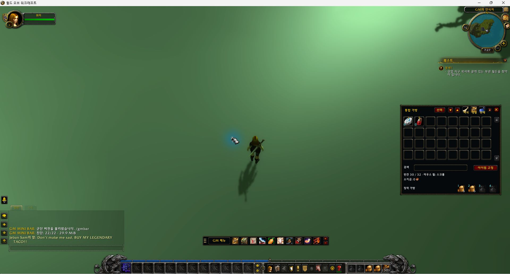
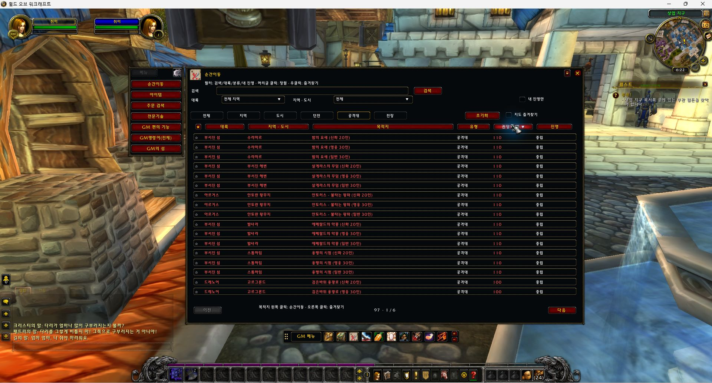
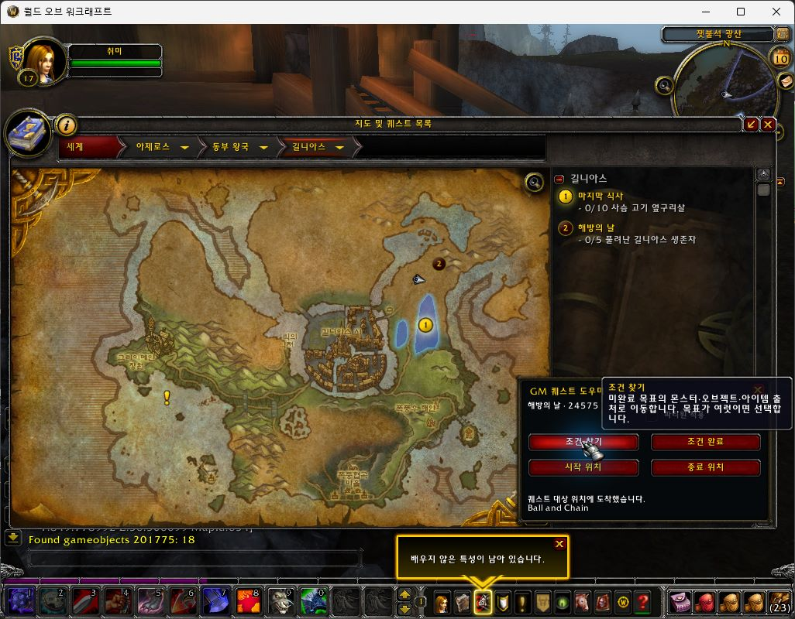

# GM MINI BAR — Legion · SPP

**[English](README.md) | [한국어](README.ko.md)**

**GM tools for WoW Legion 7.3.5 (build 26972) / SPP Legion V2 Praevius 2026.2a.** Search spells and items, manage bags, navigate quests and teleport destinations, and run GM utilities through the familiar GM MINI BAR interface. Created by **취미연구가**.

**v1.0.0 — Initial release** · [Download installation ZIP](https://github.com/hilch1981-prog/legion-gm-addon/releases/download/v1.0.0/GMminibar_SPP_Legion_7.3.5_v1.0.0.zip) · [Release notes](https://github.com/hilch1981-prog/legion-gm-addon/releases/tag/v1.0.0)

[](https://github.com/hilch1981-prog/legion-gm-addon/actions/workflows/validate.yml)

Current version: **1.0.0**, Interface **70300**, Lua **5.1**. This is the initial release baseline and includes Korean/English server quest-reply compatibility. RC labels in test records and screenshot captions identify internal development builds, not separate downloads. The installation ZIP contains exactly **one `GMminibar` folder**; no additional MPQ, DLL, SQL import or server binary replacement is required.



*Legion RC2 capture: the shared two-column GM utility layout. RC8 updates several commands and labels. All seven screenshots in this guide are actual Legion captures; their versions are recorded in [Screenshot provenance](docs/SCREENSHOTS.md).*

## Choose your client edition

| Client | Server family | Repository / guide | Downloads |
|---|---|---|---|
| Wrath 3.3.5a (12340) | AzerothCore | [Main GM MINI BAR repository](https://github.com/hilch1981-prog/azerothcore-gm-addon) | [Releases](https://github.com/hilch1981-prog/azerothcore-gm-addon/releases) |
| MoP 5.4.8 (18414) | SkyFire family | [MoP edition](https://github.com/hilch1981-prog/mop-gm-addon) | [Releases](https://github.com/hilch1981-prog/mop-gm-addon/releases) |
| Turtle WoW 1.18.1 | Tortoise | [Turtle edition](https://github.com/hilch1981-prog/turtle-gm-addon) | [Releases](https://github.com/hilch1981-prog/turtle-gm-addon/releases) |
| Legion 7.3.5 (26972) | SPP Praevius 2026.2a | **[Legion edition](https://github.com/hilch1981-prog/legion-gm-addon)** | **[v1.0.0](https://github.com/hilch1981-prog/legion-gm-addon/releases/tag/v1.0.0)** |

Install the edition matching your client and core. The editions share a design, but use different APIs, commands and data. Do not merge their `GMminibar` folders.

## Install and open

1. Download the **installation ZIP** above and close the game. Back up an existing `GMminibar` folder before replacing it.
2. Extract `GMminibar` into the Legion client's `Interface/AddOns` directory.
3. Confirm the path is `Interface/AddOns/GMminibar/GMminibar.toc`.
4. Enable **GM MINI BAR[Legion-SPP]** at character selection and log in with a character that has the required GM permissions.
5. Click **GM Menu** on the minibar or enter `/gmbar`.

GitHub's automatic **Source code** archives are for development. Players only need the named installation ZIP. Keep `WTF` to preserve settings. Server permissions and supported commands are controlled by the server; installing the addon does not grant GM access.

| Command | Action |
|---|---|
| `/gmbar` | Open GM utilities |
| `/gmbar bags` | Open unified bags |
| `/gmbar quest` | Open the quest map and helper |
| `/gmbar test` | Run client API/data diagnostics |
| `/gmbar audit` | Query supported commands/help for troubleshooting |
| `/gmbar reset` | Reset minibar position and scale |

## Language and settings

Use **English / 한국어** at the top to switch guide language. In game, use the settings gear to select **Automatic, Korean or English**, then reload the UI. Automatic follows the client locale; other client locales fall back to English. This Legion build's UI language coverage is Korean and English.

Settings include window/minibar scale, quest-helper docking, hiding GM windows in combat, auto loot, unified bags, bag sorting and automatic vendor-junk sales. Automatic sales are **off by default**. Settings persist across UI reloads. Disabling unified bags returns the bag key to the native interface.



*RC5: settings panel, including bag and combat options.*

## Features

| Area | What it provides |
|---|---|
| GM utilities | Repair, cooldown reset, stop combat, unstuck, dismount, restore appearance, water walking, save, resurrection, GM/god/flight controls, movement speed, level changes, summon, appear and respawn |
| Spell browser | Name/ID, class and level filters; at-or-below-player-level and hide-known options; learned-state colors; learn/unlearn with self-targeting |
| Item browser | Category tree, two-column results, name/ID, quality and level filters, dungeon/raid loot and item sets, quantity selection |
| Professions | 14 skills, sequential rank controls up to Legion's 800 cap, current skill/cap, maximum current rank, recipe search, learned state and bag reagent counts |
| Unified bags | Eight-column grid, four equipped-bag slots, height controls, search, selection, pinned slots, sorting and bulk-action previews; native Legion item-use handlers |
| Quest helper | Find objective, complete conditions, travel to starter/ender, and an optional party application control |
| Teleport browser | Continent, region/city, destination, type, recommended level and faction; difficulty/player-count variants, favorites and level sorting |
| Command browser | Editable command examples and server response feedback |

The offline catalog includes **104,009 item names, 179,381 named spells, 6,362 recipes and 833 travel entries**. Catalog entries are search data, not a guarantee that every record can be learned, granted or reached on every SPP installation.

Search is spread across frames. Records are stored compactly and visible rows are decoded as needed; the addon does not expand the entire catalog into per-record tables on load.

### GM utility controls

- Where a command supports other players, **left-click applies to yourself**; **right-click uses a selected player or asks for a name**. Commands requiring a nearby selected player still depend on that server requirement. Self-only commands are labeled accordingly.
- **Respawn:** left-click clears the target through a secure click and requests nearby respawn. Right-click requires a selected dead creature; players, pets and living creatures are rejected.
- **Reveal map:** left-click displays existing client map artwork; right-click restores normal fog. It does not award exploration credit, achievements or taxi access. Artwork metadata covers 111 maps and 1,521 rectangles; only selected maps have been tested in game.
- **Unstuck** uses the installed SPP server's `.start` command.
- **Maximum skill** applies `.setskill` only to learned professions below their current cap.
- This SPP build does not support several bulk-learning commands. GM/class/talent buttons open explicit spell pickers; the profession button can filter unknown recipes. The GM picker exposes the complete spell catalog. Learning a talent spell does not activate a talent selection.
- Requests and server replies are shown separately. Sending a command is not displayed as proof that it succeeded.

### Spell and item search



*RC2: Mortal Strike (12294) search and learned-state display during a learn/unlearn check.*



*RC2: item category tree, filters and two-column results. Clicking an item opens quantity selection.*

### Unified bags and minibar slots

Use your existing bag key, such as **B**, `/gmbar bags`, or **Ctrl+click the bank slot**. Four equipped-bag slots are available in the unified window. Item use follows the native Legion container handlers. Pinned slots are protected during sorting and bulk operations; sale/destruction actions show a preview.



*RC4: unified bag controls at the right and the minibar below the game view.*

Drag the minibar using its left grip. The **+/−** controls in the right-hand cell change scale by 5%. **Right-click a minibar slot to assign a hotkey**; this is different from right-clicking a utility button to select another player.

| Slot | Left-click action |
|---|---|
| 1 · GM Menu | Open GM utilities |
| 2 · Bank | Open GM bank; Ctrl+click opens unified bags |
| 3 · Quest | Open quest map and helper |
| 4 · Teleport | Open destination browser |
| 5 · Resurrection | Request self resurrection |
| 6 · GM | Toggle GM mode |
| 7 · God | Toggle invulnerability |
| 8 · Stealth | Apply/remove the stealth aura |
| 9 · Kill target | Send `.die` for the selected target |
| 10 · Flight | Toggle GM flight |
| 11 · Speed | Switch between normal and 3× movement speed |

Protected window changes and hotkey assignment wait until combat ends. Previously configured minibar command buttons can be used in combat. For SPP servers where `.die` leaves health remaining, the server administrator must check the supported `Die.Command.Mode = 1` option and reload the server configuration. The addon ZIP does not change server settings.

### Teleport destinations



*RC2: raid destinations, difficulty/player-count labels and sortable columns.*

Categories are **All / Zone / City / Dungeon / Raid / Battleground**. Flight points and class halls are grouped under Zone. Entries sort by recommended level ascending by default. Left-click travels; right-click toggles a favorite.

Dungeon/raid variants use **131 external portal landing points from WorldSafeLocs**, with supported difficulty labels. The addon waits for difficulty confirmation before teleporting. The table also includes SPP city/zone/class-hall destinations and **422 TaxiNodes flight points**. Flight-node coordinates have not all been matched against live SPP NPC spawns. **Innkeepers are not included yet.** Every destination, mounted landing and difficulty combination has not been tested.

### Quest helper



*RC7: Find Objective for quest 24575, with the helper attached to the quest map and arrival feedback.*

The helper resolves quest starters, enders and objectives through public relationship data and live server list replies. It can offer a choice between multiple objectives and prefer nearby placements on the current map. It stops when the data or response cannot be resolved instead of guessing coordinates.

The **party option** can summon eligible connected party members with the same quest after arrival. This feature has mocked coverage, but multiplayer operation has not been verified in game. Scripted events, phases and custom-server quests can differ from the reference data. The catalogs cover giver relations for 22,353 quests and 28,061 objectives across 17,822 quests; this is not a claim of universal quest support.

## Validation and known limits

The latest compatibility check is **2026-10-12**: RC8.1 fixed a reproduced Korean-reply failure, then quest 27168 End, Find Objective and Start each arrived at the intended NPC. Runtime diagnostics passed **24/24** with **zero errors in that test session**. The character returned to the original position; quest counters were unchanged, with 376 exploration XP awarded during travel. Korean gameobject replies are covered by mock fixtures; all quests and other users' PCs were not tested.

The earlier RC8 in-game checkpoint was **2026-10-10**, on **SPP 2026.2a and a 32-bit Korean 7.3.5.26972 client**. RC8 checks confirmed map artwork on/off, selected-dead and nearby creature respawn, one-click kill, unstuck travel, class/talent pickers, the unknown-recipe filter and already-at-cap skill feedback. Diagnostics passed **24/24** with no new errors in that session; one older blocked-action record was retained.

Earlier RC2–RC7 sessions checked selected spell learn/unlearn actions, item granting, potion use, bag controls, settings persistence, combat hotkeys and specific quest objective/starter/ender journeys. They are historical tests, not a fresh RC8 test of every feature. See the detailed [game test record](GMminibar/GAME_TEST.md).

Automated validation compiles **14 Lua files** and runs **295 mocked API contracts per language** (`koKR`, `enUS`). These checks do not run a game client or server. Full acceptance remains incomplete: all commands, all teleport landings, all profession rank increases and multiplayer behavior are not verified.

For a bug report, include the addon/client/server versions, selected feature, spell/item/quest or destination ID, and the diagnostic/error text. Never attach account credentials or an unfiltered `WTF` folder.

## Development, sources and license

```sh
python -m pip install -r requirements-dev.txt
python scripts/validate.py
python scripts/package.py
```

Python 3.12 is used in CI. Packaging writes one addon folder into `dist/`. `addon-manifest.json` verifies the exact source bytes. [release.json](release.json) records the v1.0.0 package hash and the relationship to the gameplay-tested development build. Renumbering does not imply a new full gameplay test. Packaging checks source integrity; game checks are recorded separately.

The generated Lua catalogs are included and require no database during play. Their upstream sources, layout hashes and regeneration history are described in [SOURCES.md](GMminibar/SOURCES.md). Historical `work/legion-audit` paths refer to the original data-generation workspace; those offline import tools and original client archives are not part of this repository.

**GPL-3.0**, with retained SPP/TrinityAdmin and GM MINI BAR attribution. See [LICENSE](LICENSE). Game names, textures and metadata belong to their respective rights holders. Icons use textures already present in the installed client.
